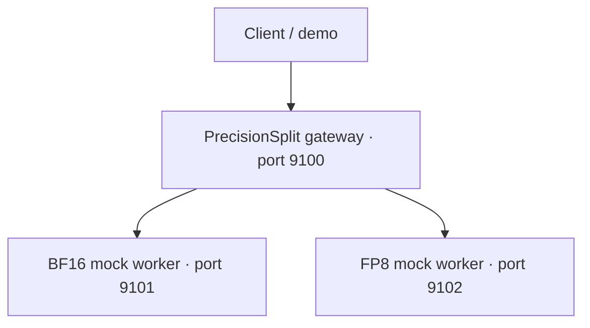

# PrecisionSplit: routing to two workers

Two independent mock HTTP workers and one gateway. No model weights, GPU,
vLLM, or Fuzzball are needed. BF16/FP8 are simulation labels; the delays are
invented demo parameters, not measurements of precision performance.

For the real two-GB10 Qwen deployment, API URL and connection commands, see
the [Fuzzball PrecisionSplit guide](../deploy/fuzzball/PRECISIONSPLIT.md).
This page documents the local mock mode; `vllm-gateway` is the separate real
OpenAI-compatible mode.

## The three processes

The client sends requests to one gateway address. The gateway chooses a worker
and forwards each request to that worker's HTTP server.



| Process | Default local address | Responsibility |
| --- | --- | --- |
| Gateway | `http://127.0.0.1:9100` | Score both workers, reserve load, maintain session affinity, forward HTTP |
| BF16 mock | `http://127.0.0.1:9101` | Run its own FIFO queue using the BF16 delay coefficients |
| FP8 mock | `http://127.0.0.1:9102` | Run its own FIFO queue using the FP8 delay coefficients |

Both workers use the same `MockWorker` implementation, started twice with
different `--mode` arguments. Each process owns a separate queue and executes
one request at a time. They do not share a model backend. The older
`local_workers/` package elsewhere in this repository is a different test setup
whose two facades forward to one shared model server.

## Start the workers and gateway

From the repository root, install the shared Python dependencies:

```sh
uv venv --python 3.12 .venv-precisionsplit
uv pip install --python .venv-precisionsplit/bin/python -r requirements-precisionsplit.txt
```

Start each command in its own terminal:

```sh
# Terminal 1
.venv-precisionsplit/bin/python -m precision_split worker --mode bf16 --port 9101
# Terminal 2
.venv-precisionsplit/bin/python -m precision_split worker --mode fp8 --port 9102
# Terminal 3
.venv-precisionsplit/bin/python -m precision_split gateway --port 9100 \
  --bf16-url http://127.0.0.1:9101 --fp8-url http://127.0.0.1:9102
```

All processes bind to localhost by default. Ports, host, worker URLs, and
gateway worker timeout are configurable through `--help`. Use one Uvicorn
process per service: queues, load reservations, and session pins are in memory.

For different ports, change the worker `--port` values and the corresponding
gateway `--bf16-url` / `--fp8-url` values together. Worker URLs are base
addresses without `/infer` or `/v1`; the forwarding code appends `/infer`.

## Run the routing demo

Run the demo with idle workers and the supplied default timing rules:

```sh
.venv-precisionsplit/bin/python -m precision_split.demo \
  --gateway-url http://127.0.0.1:9100 --output results/precisionsplit-demo.json
```

It asserts and reports:

1. An idle short request selects BF16: 0.100 s versus FP8's 0.165 s.
2. A longer request occupies BF16; a new short session selects FP8 because
   its predicted finish is sooner.
3. A follow-up to the first session stays on BF16 and waits in its FIFO queue,
   despite FP8 being idle. All reservations are released afterward.

The busy request and follow-up run concurrently from the client. The demo
waits for observable assignment/worker state rather than guessing startup
delays. Reports include both scores, decisions, worker identities and queue
waits. Assignment/release events are also JSON logs in the gateway terminal.

## Send a request

```sh
curl -s http://127.0.0.1:9100/infer -H 'Content-Type: application/json' \
  -d '{"session_id":"chat-1","input_length":10,"expected_output_length":10}'
curl -s http://127.0.0.1:9100/state
```

| Request field | Meaning |
| --- | --- |
| `session_id` | Optional, nonempty conversation identifier. Reusing it preserves worker assignment. |
| `input_length` | Required nonnegative integer representing synthetic input tokens. |
| `expected_output_length` | Required nonnegative integer representing the expected synthetic output tokens. |

Lengths are synthetic token counts, supplied explicitly; no tokenizer runs.
Responses return the session ID, routing scores and dummy worker response.
Omitting `session_id` creates a new session; reuse the returned ID for affinity.
Workers expose `/health`, `/state`, and `/infer`; direct worker `/infer` requests
also require a unique `request_id`. Direct traffic bypasses gateway accounting.
Gateway `/health` checks its own process, not backend availability.

The response contains `routing.worker`, `routing.reason`, and both workers'
`routing.scores`. `result.worker` identifies the process that actually handled
the request. Its `service_seconds`, `queue_wait_seconds`, and
`processing_seconds` distinguish the configured delay from actual waiting and
processing. The worker returns dummy text rather than generated model output.

## How the gateway calculates each score

All three processes read `precision_split/timings.json`. To change delays,
pass the **same** `--timings /path/to/timings.json` to each process and restart:

For each worker, calculate the service estimate for the new request:

```text
service_seconds = base_seconds
                + input_seconds_per_token × input_length
                + output_seconds_per_token × expected_output_length
```

The default coefficients are:

| Coefficient | BF16 mock | FP8 mock |
| --- | ---: | ---: |
| Base seconds | 0.05 | 0.10 |
| Seconds per input token | 0.001 | 0.0005 |
| Seconds per expected output token | 0.004 | 0.006 |

For input length 10 and expected output length 10:

```text
BF16 service = 0.05 + 0.001 × 10 + 0.004 × 10 = 0.100 seconds
FP8 service  = 0.10 + 0.0005 × 10 + 0.006 × 10 = 0.165 seconds
```

Add work the gateway has already assigned to that worker:

```text
remaining_work = max(0, estimated_head_service - elapsed_head_time)
               + sum(full_service_estimates_for_queued_requests)

predicted_finish_seconds = remaining_work + new_request_service_seconds
```

The score is estimated seconds from now until completion, not an absolute
timestamp. This is greedy routing: a new session chooses the smallest current
score. It does not plan future arrivals. Equal scores choose the alphabetically
first worker name, which is `bf16` for this pair.

An idle worker has zero remaining work. The estimated head starts at reservation
time; its remaining estimate decreases as time passes. Queued reservations keep
their full estimates until they become the head. Releasing the head starts the
next reservation's estimated clock. An overdue head stays reserved with zero
estimated remaining time until completion or failure releases it. These are
estimates, not measurements of the worker's current execution position.

The worker calculates its sleep duration using the same service-time function
and timing file. Network and HTTP overhead are not modeled. Worker FIFO order
is HTTP arrival order; independent HTTP arrivals can differ from gateway
assignment order.

## One request, from arrival to completion

1. The gateway validates the lengths and obtains the session ID. It generates
   an ID when the client omitted one.
2. It acquires the routing lock and calculates both workers' scores.
3. For a new session, it chooses the smaller score. For an existing session,
   it selects the session's pinned worker even when the other score is lower.
4. While still holding the lock, it adds a reservation to the selected worker,
   saves the session assignment, and logs the decision with both scores.
5. It releases the lock and forwards the HTTP request to that worker.
6. The worker puts the request in its own FIFO queue. Its single consumer
   sleeps for the configured service duration, then returns the dummy result.
7. The gateway returns the result and routing details to the client. Its
   `finally` block releases the reservation, including on forwarding failure
   or cancellation. Follow-ups use this same reservation lifecycle.

### Why concurrent requests do not overlook assigned work

The lock covers selection **and** reservation insertion. A second request
cannot score the workers between the first request choosing a worker and
recording its load. HTTP forwarding happens after that reservation is visible.

For example, for two simultaneous short requests to idle workers, ignoring
elapsed overhead:

| Arrival | BF16 score | FP8 score | Choice |
| --- | ---: | ---: | --- |
| First new session | 0.100 s | 0.165 s | BF16 |
| Second new session | 0.100 s reserved + 0.100 s new = 0.200 s | 0.165 s | FP8 |

This accounts for assigned work even if its HTTP call has not reached the
worker yet. The gateway does not poll workers to build this local estimate.
Direct traffic to a worker is therefore absent from the gateway's ledger.

### How session affinity changes selection

The gateway stores a map such as `chat-1 -> bf16`. Every request carrying
`session_id: "chat-1"` uses BF16 and adds another reservation there. Both scores
are still recorded, and the decision reason becomes `session_affinity`.

Affinity can intentionally choose a worker with a later predicted finish.
The mapping survives request completion but lasts only for the lifetime of the
gateway process. It does not store conversation messages or implement a model
cache. With real models, the client must supply conversation history, and
actual prefix-cache reuse must be verified separately.

## Understand the demo's three decisions

The demo first completes a short request on BF16, establishing its session pin.
It then starts a new, longer request with input length 1,000 and expected
output length 500. Its idle estimates are 3.05 seconds on BF16 and 3.60 seconds
on FP8, so it occupies BF16 while the demo sends the next two requests.

| Case | BF16 score | FP8 score | Expected result |
| --- | --- | --- | --- |
| Initial short request | 0.100 s | 0.165 s | BF16 wins on service time |
| New short session while BF16 is busy | Roughly 3 s of remaining work + 0.100 s | 0.165 s | FP8 wins on finish time |
| Follow-up to the original session, after FP8 finishes | Still higher than FP8 | 0.165 s | BF16 is selected by affinity and the request queues |

Exact loaded scores depend on elapsed time. The demo asserts the comparisons,
checks that the follow-up is queued behind the long request, verifies FIFO
sequence order, and confirms that both reservation counts return to zero.

## Inspect decisions and queues

Gateway assignment logs are JSON records containing:

- `worker`, `request_id`, `session_id`, and `reason`.
- `scores.bf16` and `scores.fp8`, each with remaining work, estimated service,
  predicted finish, and the prior assigned-request count.
- `assigned_requests_after` for the selected worker.

A later `release` log records completion/failure and the resulting count.
Worker `worker_start` logs identify the process, request and FIFO sequence.

`GET /state` on the gateway shows its reservations and session map.
`GET /state` on either worker shows its actual running request, queued count
and completed count. These expose different views: gateway estimates versus
worker execution. The demo JSON also preserves the scores, responses and queue
snapshot for inspection.

## Code map

| File | Responsibility |
| --- | --- |
| [`__main__.py`](__main__.py) | Parse mode, port, URLs and timing-file arguments; start one HTTP process |
| [`apps.py`](apps.py) | Request validation, HTTP endpoints, FIFO mock worker and request lifecycle |
| [`routing.py`](routing.py) | Score workers, pin sessions and atomically reserve/release estimated work |
| [`forwarding.py`](forwarding.py) | Send HTTP to the selected worker; no routing policy |
| [`timing.py`](timing.py) and [`timings.json`](timings.json) | Shared delay calculation and coefficients |
| [`demo.py`](demo.py) | Exercise and verify all three routing cases over HTTP |
| [`../tests/test_precision_split.py`](../tests/test_precision_split.py) | Concurrency, affinity, FIFO and failure/cancellation checks |

## Mock-mode limits and failures

The prototype scores both configured workers without backend health filtering.
Upstream failures return 502, or 504 for timeouts, with no automatic retry or
failover. A failed session remains pinned. A timeout can leave actual upstream
work running after its reservation is released; real deployment needs upstream
cancellation or reconciliation with telemetry.

Queues and session maps have no configured size/expiry limits. Reservations
and pins are local to one gateway process and are lost on restart. Running
multiple independent gateway processes would split this state and invalidate
the shared load estimate. The mock API does not accept real model messages or
provide OpenAI-compatible generation/streaming.

## Run tests

```sh
.venv-precisionsplit/bin/python -m unittest discover -s tests -v
```

## Later deployment on the two GB10 machines

Fuzzball would run three persistent services: a CPU PrecisionSplit gateway and
one GPU vLLM worker on each GB10. The gateway can share a machine's CPU
resources with its GPU worker. Fuzzball manages placement and service lifetime;
PrecisionSplit chooses the destination of each inference request.

Both engines must use the same pinned checkpoint and engine build. Configure
one with BF16 attention KV and the other with supported, verified FP8 KV using
the [launch profiles](../docs/precision-profiles.md). Model weight format and
Mamba state dtypes are separate settings. Each engine owns its GPU cache.

The real request adapter is now implemented in `vllm_gateway.py` and
`VLLMForwarder` in `forwarding.py`, including token counting, health filtering,
streaming and reservation cleanup. The
[deployment guide](../deploy/fuzzball/PRECISIONSPLIT.md) records the running
services and tested connection path. The remaining production/benchmark work is:

1. Obtain individually addressable worker URLs, served model IDs, metrics URLs,
   and approved authentication. A second load balancer must preserve the
   selected worker rather than independently redistributing the request.
2. Use the `vllm-gateway` mode for `/v1/chat/completions` and real messages.
   The original mock `gateway` mode continues to serve `/infer`. Supply the
   approved authentication for the chosen network route.
3. Replace invented timing coefficients with matched benchmark estimates and
   live queue/cache/load signals. vLLM batches requests, so the serial FIFO
   estimate in this demo must be revised and validated against real workloads.
4. Preserve session affinity, verify effective worker configuration and cache
   behavior, then compare routed results with direct-to-worker baselines.

Changing `--bf16-url` and `--fp8-url` alone in mock `gateway` mode is insufficient:
that adapter still calls `/infer`. See the [gateway experiment guide](../docs/03-gateway-system.md)
for the later profiling and evaluation plan.
